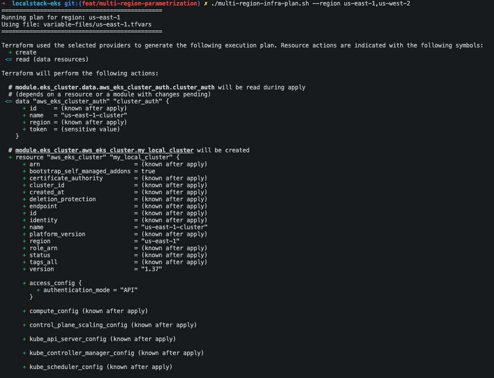
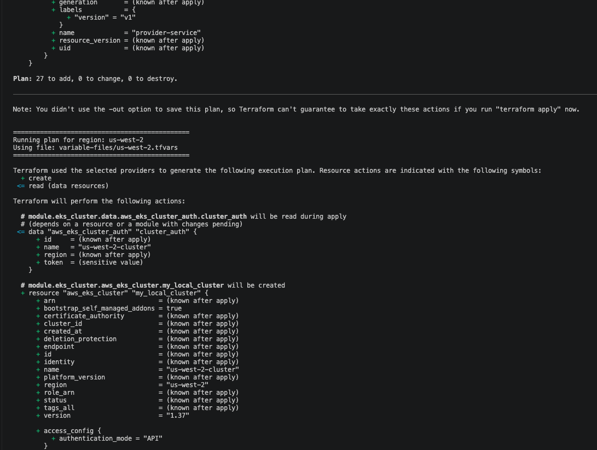

# LocalStack EKS example


TL;DR
- Single line - install and setup all
    > ./setup.sh

## Requirements
- MacOS v26.6.2+
  > It could work on previous MacOS versions or even a linux distribution, but this was the OS the development files were tested on
- docker v29.9.1   
  ```sh
  brew install docker@29.9.1
  ``` 
- colima v0.9.1   
  ```sh
  brew install colima@0.9.1
  ```
- docker-compose v5.6.0   
  ```sh
  brew install docker-compose@5.6.0
  ```
- tfenv v3.2.2 - Not required, but convenient to install   
  ```sh
  brew install tfenv@3.2.2
  ```
- terraform v1.16.6   
  ```sh
  tfenv install 1.16.6
  ```
- LocalStack (lstk) v1.4.1   
  ```sh
  brew install localstack/tap/lstk@1.4.1
  ```

## Setup
### First-time setup
```sh
brew link docker # so colima can start the docker runtime
colima start --cpu 4 --memory 8 --disk 50
tfenv use 1.16.6
lstk start
# In your browser, setup your account as a hobbyist so you don't require to pay for anything
# Back in your terminal, select AWS emulator and create a profile in your ~/.aws/config file, which should be named 'localstack' by default
lstk login
```

### Resuming development
Let's say you turned off your computer and you want to resume what you were working on. Chances are that `lstk` logged out or the colima machine stopped, so you would need to repeat the commands from the first-time setup, except `brew link docker`
```sh
colima start
tfenv use 1.16.6 # just in case you were using a different version
lstk start
lstk login
```

## Working with IAM permissions
We have a three service/namespace setup, on which each service has its own IAM policy with specific actions based on these hypotethical situations:
<details>
  <summary>Individual service/namespace IAM details</summary>

#### Payments Service
[Policy file](iam-policies/payments-service.json.tmpl)   
We have PC hardware store, so this service handles payments on user orders.   
`sqs:ReceiveMessage` is used when a new payment is logged, so our service can handle payment confirmation and trigger the order dispatch workflow.   
`sns:Publish` is used when the payment service notifies the topic being monitored to trigger order dispatch workflows.   
`ssm` permissions are used to obtain the DB credentials to update the order status.   
We don't have any RDS permissions because we're assuming the payment service connects to the DB via a DB connector (in code) instead of an IAM DB authentication mechanism. We're also assuming we don't have a CRD for external secrets management.

### Profile
[Policy file](iam-policies/profile.json.tmpl)   
Users have their own profiles to manage basic info like profile picture, addresses and orders.   
`s3` permissions are used for retrieving data like a profile picture or custom computer configurations.   
Interaction with RDS and SSM is handled the same as with the payments service.

### Provider Service
[Policy file](iam-policies/provider-service.json.tmpl)   
The store works in collaboration with official distributors for the main PC hardware brands, so with the provider service, the orders for new stock for the store are handled.   
`sns:Publish` permission is used when a new order is generated so it can be sent to the provider.   
Interaction with RDS and SSM is handled the same as with the payments service.
</details>

### How these permissions would be subjected to peer review:
- Validate there are no wildcard service permissions. e.g. `ssm:*`
- Validate there are no resource wildard reference. e.g. `"Resource": "*"`
- There is no harcoded account nor region, because these should be handled with variables: e.g.   
  ❌  `"Resource": "arn:aws:ssm:us-east-1:123412341234:parameter/profile-service/*"`   
  ✅  `"Resource": "arn:aws:ssm:${region}:${account_id}:parameter/profile-service/*"`   
- Destroying actions are granted only to dedicated services.


## Working with multi-region deployments
This exercise is not tested up until `terraform apply`, it's just tested until the plan stage so we can validate the resources that need to be created and how they connect with each other.

This approach was selected because a single terraform state shouldn't manage resources spanding more than one region.   

You need to execute the [multi-region-infra-plan](multi-region-infra-plan.sh) file by passing the regions you want terraform to run a plan on, for which you should have a variables file corresponding to the region name. e.g.
```shell
./multi-region-infra-plan.sh --region us-east-1,us-west-2
```



